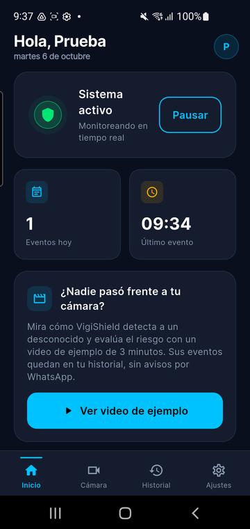
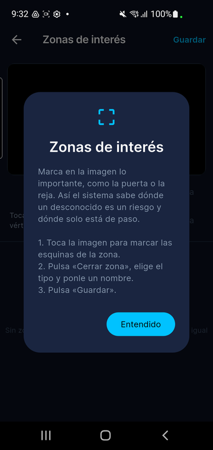
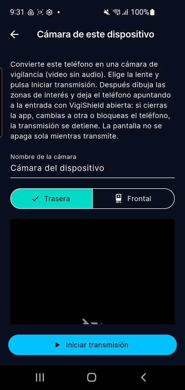
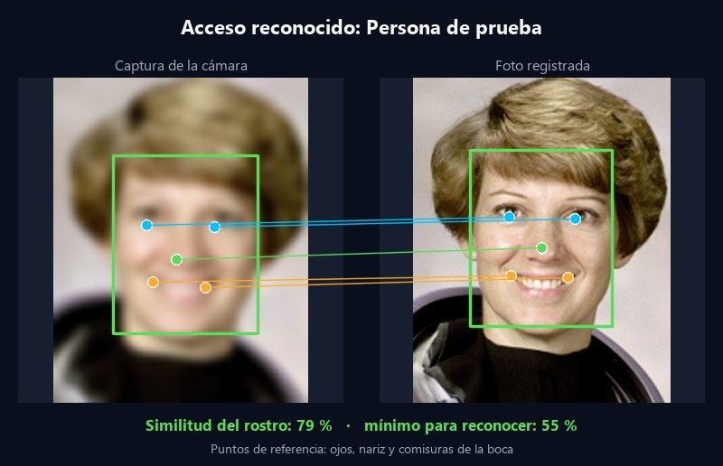
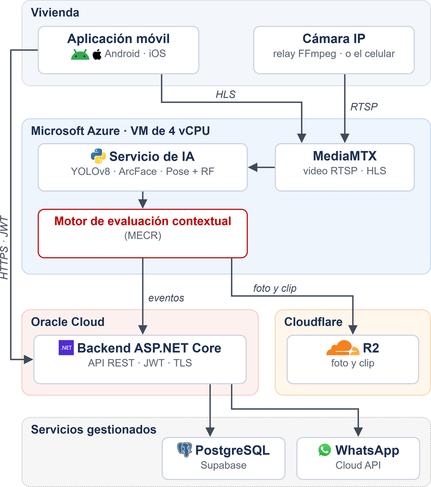

# VigiShield — aplicación móvil

App de **VigiShield**, un sistema de seguridad para viviendas que analiza el video de las cámaras del hogar
con inteligencia artificial y avisa cuando una situación representa un riesgo. La app es la cara visible del
sistema: muestra las cámaras en vivo y en modo IA, guarda cada evento con su foto y su clip, y lanza la alerta
de emergencia.

Proyecto de tesis de Ingeniería de Software (UPC, 2026).

<p align="center">
  
  
  
</p>

## Qué hace

- **Cámaras:** cámaras IP de la casa (RTSP) y, como alternativa, el propio celular como cámara (WebRTC/WHIP).
- **Video en vivo y modo IA:** el modo IA dibuja a cada persona con su identidad y su nivel de riesgo.
- **Zonas de interés:** el usuario marca sobre la imagen la puerta, la reja, el patio o la calle.
- **Rostros:** registro guiado de los residentes autorizados con la cámara frontal.
- **Historial:** cada evento con foto, clip de unos 12 s, nivel de riesgo y cámara. En un acceso reconocido se
  ve el rostro capturado junto a la foto registrada; en una persona desconocida, su rostro y la opción
  «Es alguien conocido».
- **Alertas:** aviso en vivo, alerta de emergencia a pantalla completa (con la app abierta) y WhatsApp.
- **Hogar:** el residente principal invita a otros residentes; cada uno puede eliminar su cuenta desde la app.
- **Tutorial guiado** la primera vez y **video de ejemplo** para probar sin cámara propia.
- Español e inglés.

<p align="center">
  <br>
  <sub>Detalle de un acceso reconocido (ejemplo con una foto de dominio público de la NASA).</sub>
</p>

## Arquitectura

La app no procesa video: lo reproduce y consulta a dos servicios en la nube.

<p align="center"></p>

| Repositorio | Qué hace |
|---|---|
| **VigiShield-MobileApp** (este) | App Flutter para Android e iOS |
| [VigiShield-Main-Backend](https://github.com/TP202610071/VigiShield-Main-Backend) | API REST (ASP.NET Core) con cuentas, cámaras, eventos y alertas |
| [VigiShield-AI-Backend](https://github.com/TP202610071/VigiShield-AI-Backend) | Servicio de IA (Python) y servidor de video (MediaMTX) |

| Servicio | URL |
|---|---|
| API | `https://api.vigishield.app` |
| Video e IA | `https://api-ai.vigishield.app` (RTSP 8554, HLS por HTTPS, `/ai/...` con JWT) |
| Web, términos y privacidad | `https://vigishield.app` |

Si el servidor de video está apagado (se apaga fuera de las pruebas para ahorrar costos), la pestaña Cámara
lo explica en vez de quedarse cargando.

## Tecnologías

Flutter 3 · Dart · Provider · go_router · Dio · media_kit (RTSP/HLS) · flutter_webrtc (celular como cámara) ·
Google ML Kit (detección de rostro en el registro) · flutter_secure_storage · local_auth (biometría) ·
app_links (enlaces a eventos).

## Estructura

```
lib/
  core/        configuración, red (ApiClient), textos ES/EN, tema, orientación y seguridad
  data/        modelos y servicios que llaman a la API
  providers/   estado de la app (sesión, cámaras, eventos, sistema…)
  router/      rutas (go_router)
  screens/     pantallas: inicio, cámara, historial y ajustes
  widgets/     componentes reutilizables (tarjetas, tutorial, avisos…)
test/          pruebas de widgets, proveedores y servicios
```

## Compilar y ejecutar

```bash
flutter pub get
flutter run                      # apunta por defecto a https://api.vigishield.app
flutter test                     # pruebas
flutter build apk --release      # Android (build de tienda)
flutter build ipa --release      # iOS (en una Mac; ver CLAUDE.md)
```

- El build de release es el de tienda: no incluye las herramientas de validación de la tesis.
- La versión va en `pubspec.yaml` (`x.y.z+N`). Mientras la 1.0.0 esté en preparación en App Store Connect,
  solo sube el número de build.
- La interfaz va en vertical; solo la pestaña Cámara y el clip a pantalla completa giran a horizontal.

## Privacidad

Las fotos de rostros y los eventos pertenecen a cada hogar y se borran al eliminar la cuenta. Términos y
política de privacidad: <https://vigishield.app/privacidad> (Ley N.º 29733).
